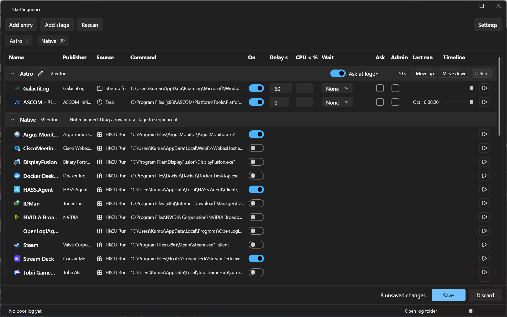
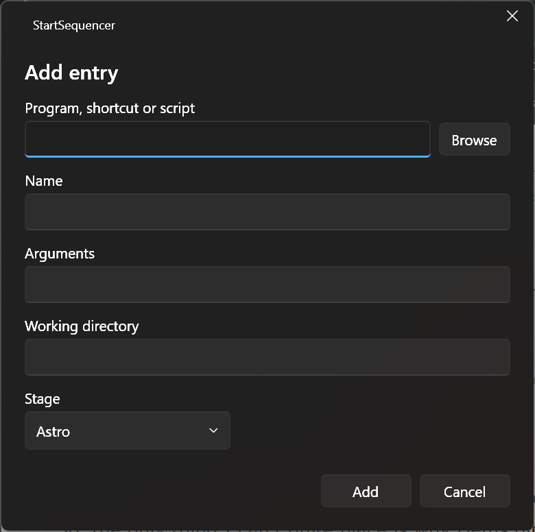

<p align="center">
  
</p>

<h1 align="center">StartSequencer</h1>

<p align="center">
  A startup manager for Windows 11 that starts your logon programs in the order you choose.
</p>

<p align="center">
  <a href="https://github.com/chvvkumar/start-sequencer/actions/workflows/ci.yml"></a>
  <a href="https://github.com/chvvkumar/start-sequencer/releases"></a>
  
  
</p>

Windows starts every logon program at once. StartSequencer lists them all in one window, from the registry Run keys, the two Startup folders, Task Scheduler logon tasks and Microsoft Store startup tasks. It enables and disables entries through the same switches Task Manager uses. Drag an entry into a stage and StartSequencer takes it over: at logon it starts the stage's entries one after another, with per-entry delays, a CPU gate, wait conditions, an optional confirmation dialog and per-entry elevation. Each logon run writes a JSON log, so you can see what started when.



## Features

- One list of every logon program, grouped by stage, with icon, publisher, source and command line.
- Enable and disable entries with the switches Windows itself uses (`StartupApproved`, task enabled flag, Store `State`). Nothing is deleted or rewritten.
- Stages run in order. Within a stage, entries run top to bottom.
- Per entry: delay in seconds, start only when CPU use drops below a threshold, wait for a window or for exit before the next entry, ask at logon, run elevated.
- Ask dialog at logon with a countdown. Stays on top without stealing focus from a fullscreen game or video.
- Elevated entries run through a per-entry scheduled task, so no UAC prompt appears at logon.
- Add your own programs, shortcuts, batch files and PowerShell scripts.
- Timeline bar per entry and per boot, fed by a JSON boot log kept for the last 30 logons.
- Explicit Save. Nothing changes on the system until you click Save, and changes under HKLM go through one UAC prompt.
- Export and import the configuration as JSON.
- Uninstall restores every entry to the state it had when the app first saw it.

## Getting started

Download `StartSequencer-<version>-win-x64.zip` from the [releases page](https://github.com/chvvkumar/start-sequencer/releases), unzip it to a permanent folder and run `StartSequencer.exe`. The exe needs the .NET 10 Desktop Runtime, see [Requirements](#requirements).

> [!IMPORTANT]
> Keep the exe where you first ran it. The logon task stores the exe's full path. If you move the exe, open the main window once from the new location and the task is re-registered.

Then:

1. Click **Add stage** and name it. Add more stages for groups that should start later.
2. Drag rows from **Native** into a stage. The app disables the entry at its source so Windows does not also start it, and starts it itself from now on.
3. Set a delay, a CPU threshold or a wait mode per entry, and turn on **Ask** for entries you want to confirm at logon.
4. Click **Save**. Changes under HKLM or to protected tasks bring up one UAC prompt.
5. Sign out and back in. The status line at the bottom shows the last boot log.

To add something that is not a startup entry yet, click **Add entry**:

<p align="center">
  
</p>

> [!NOTE]
> Store apps can be enabled, disabled and run now, but not sequenced. See [Limitations](#limitations).

## Requirements

- Windows 11, x64.
- .NET 10 Desktop Runtime (`Microsoft.WindowsDesktop.App` 10.x) to run the exe. The build is framework-dependent, so the runtime is not bundled.
- .NET 10 SDK to build from source. Verified with SDK 10.0.401 and Desktop Runtime 10.0.12.
- A per-user .NET install (under `%LOCALAPPDATA%\Microsoft\dotnet`, as `winget` or `dotnet-install.ps1` can produce) is not found by the exe unless `DOTNET_ROOT` points to it. The scheduled logon task starts the exe outside any shell, so set the variable at user level and sign out and back in:

```powershell
[Environment]::SetEnvironmentVariable('DOTNET_ROOT', "$env:LOCALAPPDATA\Microsoft\dotnet", 'User')
```

A machine-wide install in `C:\Program Files\dotnet` needs no variable. When the runtime is not found, the exe exits with code -1 and Windows writes a ".NET application failed" event to the Application log that lists the searched locations.

## Build

Run from the repository root.

```powershell
dotnet build src/StartSequencer
```

Run the tests. Some tests start Notepad; close any open Notepad windows first.

```powershell
Get-Process notepad -ErrorAction SilentlyContinue | Stop-Process
dotnet test tests/StartSequencer.Tests
```

Produce a single-file exe in `publish\`:

```powershell
dotnet publish src/StartSequencer -c Release -r win-x64 --self-contained false -p:PublishSingleFile=true -o publish
```

The output is `publish\StartSequencer.exe` (about 7.5 MB) and `StartSequencer.pdb`. The `publish` folder is ignored by git. Copy the exe to a permanent location before the first Save: the logon task stores the exe's full path, so moving the exe later breaks the task until the main window is opened from the new location, which re-registers the task.

To confirm the exe finds the runtime without opening a window, run an elevated-operation file that does not exist. Exit code 1 means the runtime loaded and the app reported the missing file:

```powershell
$p = Start-Process .\publish\StartSequencer.exe -ArgumentList '--elevated-op', "$env:TEMP\ss-check.json", '0' -Wait -PassThru
$p.ExitCode
Remove-Item "$env:TEMP\ss-check.json.result"
```

## Releases

Work lands on the `snd` branch, then moves to `dev` and then to `main`. GitHub Actions builds and tests every push and pull request to `snd`. The CI test run skips tests marked with the `Desktop` trait, because they need an interactive desktop session. Run those locally. `dev` and `main` are promotion branches and run no tests.

Every push to a release branch publishes the single-file exe as a GitHub release. The tag depends on the branch and on the `<Version>` value in `src/StartSequencer/StartSequencer.csproj`:

| Branch | Tag | Marked as |
|---|---|---|
| `snd` | `v<Version>-alpha.<run number>` | pre-release, after the tests pass |
| `dev` | `v<Version>-beta.<run number>` | pre-release |
| `main` | `v<Version>` | release |

The attached file is `StartSequencer-<tag>-win-x64.zip`. If the tag already exists, the job fails and nothing is published.

To cut a release, raise `<Version>` in `src/StartSequencer/StartSequencer.csproj` on `snd`, let the tests pass, then merge `snd` into `dev` and `dev` into `main`.

## Run

`StartSequencer.exe` runs unelevated (`asInvoker`). The argument selects the mode:

| Command | Mode |
| --- | --- |
| `StartSequencer.exe` | Main window. |
| `StartSequencer.exe --launch` | Launcher. Runs the saved sequence, writes a boot log, exits. The logon task uses this. |
| `StartSequencer.exe --elevated-op <file> <sha256>` | Applies the admin operations listed in the JSON file, writes `<file>.result`, exits 0 on success or 1 on any error. The file is refused when it is larger than 1 MB or its SHA-256 differs from `<sha256>`. The result file is not written over an existing file or link. The app starts this mode itself through a UAC prompt. |
| `StartSequencer.exe --uninstall` | Restores original startup states and removes the scheduled tasks. See Uninstall and restore. |

The main window has these parts:

- Toolbar: Add entry, Add stage, Rescan, and Settings.
- One list grouped by stage. Stages appear in their configured order. The last group, Native, holds entries the app does not manage. Drag a row into a stage to manage it there; drag it back to Native to stop managing it. A stage header has the stage name (editable), an Ask switch, the cumulative planned seconds, move up and down buttons, and a delete button.
- Each row shows icon, name, publisher, source, command (full text in the tooltip), enabled switch, delay, CPU gate, wait mode, ask, admin, last run time, a timeline bar with the planned offset and the last boot's actual launch time, and a run-now button. An amber dot marks an entry that is new since the last Save. Read-only rows have their controls disabled. A managed entry whose source no longer exists (a deleted Run value, file or task) stays in its stage as a read-only row with the location "Source entry not found"; move it to Native to remove it from the config.
- Save bar: appears when there are unsaved changes, with the change count, Save and Discard. Nothing is written to the system or to the config file until Save. Closing the window with unsaved changes asks Save, Discard or Cancel.
- Status line: summary of the last boot log with a timeline bar for the whole boot, and a link to the log folder.
- Settings flyout: global delay, ask countdown, a Show Windows tasks checkbox, Export, Import, Uninstall.
- Add entry dialog: file (exe, shortcut, batch, cmd or PowerShell script), name, arguments, working directory, stage. Added entries exist only in the config file.

## How discovery works

Each scan reads the sources below. A failure in one source is reported and does not stop the others. Every entry gets a stable key (`<prefix>|<id>`) used in the config and logs.

| Source | Key prefix | Location read | Enable and disable mechanism | Read-only cases |
| --- | --- | --- | --- | --- |
| HKCU Run | `HKCU-Run` | `HKCU\Software\Microsoft\Windows\CurrentVersion\Run` | `HKCU\...\Explorer\StartupApproved\Run` | none |
| HKCU Run, 32-bit | `HKCU-Run32` | `HKCU\Software\Wow6432Node\Microsoft\Windows\CurrentVersion\Run` | `HKCU\...\Explorer\StartupApproved\Run32` | none |
| HKCU RunOnce | `HKCU-RunOnce` | `HKCU\Software\Microsoft\Windows\CurrentVersion\RunOnce` | none | always |
| HKLM Run | `HKLM-Run` | `HKLM\Software\Microsoft\Windows\CurrentVersion\Run` | `HKLM\...\Explorer\StartupApproved\Run` (UAC) | none |
| HKLM Run, 32-bit | `HKLM-Run32` | `HKLM\Software\Wow6432Node\Microsoft\Windows\CurrentVersion\Run` | `HKLM\...\Explorer\StartupApproved\Run32` (UAC) | none |
| HKLM RunOnce | `HKLM-RunOnce`, `HKLM-RunOnce32` | `HKLM\Software\Microsoft\Windows\CurrentVersion\RunOnce` and the Wow6432Node equivalent | none | always |
| User Startup folder | `Folder-User` | `%APPDATA%\Microsoft\Windows\Start Menu\Programs\Startup` | `HKCU\...\Explorer\StartupApproved\StartupFolder` | none |
| Common Startup folder | `Folder-Common` | `%ProgramData%\Microsoft\Windows\Start Menu\Programs\StartUp` | `HKLM\...\Explorer\StartupApproved\StartupFolder` (UAC) | none |
| Task Scheduler | `Task` | Every task folder, tasks with at least one logon trigger | Task enabled flag; UAC when the task denies the change to a standard user | tasks under `\Microsoft\`, which are hidden unless Show Windows tasks is checked |
| Store apps | `Store` | `HKCU\Software\Classes\Local Settings\Software\Microsoft\Windows\CurrentVersion\AppModel\Repository\Packages`, then each package's `AppxManifest.xml` for `windows.startupTask` extensions | `State` DWORD under `HKCU\...\AppModel\SystemAppData\<PackageFamilyName>\<TaskId>` | when `State` is 3 or 4 (set by policy) |
| Added in the app | `Custom` | `config.json` only | managed by the app | none |

Details:

- `...\Explorer\StartupApproved` is short for `Software\Microsoft\Windows\CurrentVersion\Explorer\StartupApproved`. Registry reads use the 64-bit view with explicit `Wow6432Node` paths.
- A StartupApproved value is 12 bytes of binary data named after the Run value or the Startup folder file name. First byte with bit 0 clear (`02`, `06`) means enabled, bit 0 set (`03`) means disabled. A missing value means enabled.
- Run values that are not strings are skipped. `desktop.ini` in the Startup folders is skipped.
- Tasks under `\StartSequencer\` are never listed.
- Command lines are split into program and arguments. A quoted program path ends at the closing quote. An unquoted line takes the shortest prefix that exists as a file after environment variable expansion. Shortcuts are resolved to their target, arguments and working directory.
- Publisher comes from the exe's version resource, the task author, or the Store package display name.
- An entry is marked new when its key is not in `knownKeys` in the config. Save adds all current keys.
- The first time a key is seen, its enabled state is recorded in `nativeSnapshot`. Uninstall restores entries to this state. Read-only entries (RunOnce, tasks under `\Microsoft\`, Store entries set by policy) are not recorded.
- A task can be sequenced only when it has exactly one action and that action starts a program. Other tasks show "Task has no single program action" and cannot be dragged into a stage. Sequencing disables the whole task, so its other triggers (time, event) stop firing too.

## What the app changes on the system

Writes happen only on Save in the main window, on Uninstall, and when the launcher saves ask-dialog defaults to `config.json`. The launcher never writes to the registry. Every registry write is read back, and a mismatch is reported as an error.

| Change | When | Where |
| --- | --- | --- |
| StartupApproved values | An entry is enabled or disabled, or is managed (the app disables it at its source so Windows does not also start it) | `HKCU\Software\Microsoft\Windows\CurrentVersion\Explorer\StartupApproved\{Run,Run32,StartupFolder}` directly. The same path under `HKLM` through one UAC prompt per Save. |
| Task enabled flag | A logon task is enabled, disabled or managed | The task itself. If the change is denied unelevated, it is retried in the UAC step. |
| Store `State` values | A Store startup task is toggled | `HKCU\Software\Classes\Local Settings\Software\Microsoft\Windows\CurrentVersion\AppModel\SystemAppData\<PackageFamilyName>\<TaskId>\State`: 2 enabled, 1 disabled by user. The key is created if missing. |
| Scheduled task `\StartSequencer\Logon` | Save with at least one managed entry. Deleted on Save with none. Re-registered when the main window starts and the task's program path differs from the running exe. | Logon trigger for the current user, no delay, runs `"<exe path>" --launch` with the exe folder as working directory, standard (limited) privileges, interactive token, no time limit, starts when available, ignores a second instance, runs on battery. |
| Scheduled tasks `\StartSequencer\Elevated\<key>` | Save after an entry's Admin box is checked. Deleted when the box is cleared or the entry is unmanaged. Created and deleted through the UAC step. | No triggers. Highest run level, interactive token. Action is the entry's program, arguments and working directory. `<key>` is the entry key with `\ / : * ? " < > \|` replaced by `_`, for example `\StartSequencer\Elevated\Custom_3f2a9c...`. |
| `%APPDATA%\StartSequencer\config.json` | Save, Import, launcher ask defaults | Written to `config.json.tmp`, then moved over `config.json`. |
| `%APPDATA%\StartSequencer\logs\` | Each launcher run | Boot logs. See Logs. |
| `%TEMP%\ss-ops-<guid>.json` and `.result` | During a UAC step | The operations list for the elevated process and its result. The command line carries the list's SHA-256, and the elevated process refuses a changed list. Deleted afterwards. |

The app does not delete or edit Run values, Startup folder files or task definitions of native entries.

Example `config.json`, trimmed:

```json
{
  "version": 1,
  "sequencerEnabled": true,
  "globalDelaySeconds": 10,
  "askCountdownSeconds": 20,
  "showWindowsTasks": false,
  "stages": [
    { "name": "Core", "ask": false },
    { "name": "Comms", "ask": true },
    { "name": "Background", "ask": false }
  ],
  "managed": [
    {
      "key": "HKCU-Run|Discord",
      "stage": "Comms",
      "order": 0,
      "enabled": true,
      "delaySeconds": 5,
      "cpuBelowPercent": 30,
      "cpuWaitCapSeconds": 120,
      "wait": "Window",
      "waitSeconds": 5,
      "windowTimeoutSeconds": 30,
      "ask": false,
      "elevated": false
    }
  ],
  "custom": [
    {
      "key": "Custom|3f2a9c0e8b6d4b1f9a7e5c3d2b1a0f9e",
      "name": "sync",
      "path": "C:\\Tools\\sync.cmd",
      "arguments": "",
      "workingDirectory": "C:\\Tools"
    }
  ],
  "nativeSnapshot": {
    "HKCU-Run|Discord": true,
    "Task|\\Adobe\\AdobeUpdater": true
  },
  "knownKeys": [ "HKCU-Run|Discord", "Task|\\Adobe\\AdobeUpdater" ],
  "askDefaults": { "Stage|Comms": true }
}
```

## Sequencing

The launcher (`--launch`) runs at logon through `\StartSequencer\Logon` and does nothing unless `sequencerEnabled` is true.

1. Wait `globalDelaySeconds` (default 10).
2. Scan all sources, to resolve each managed key to a program and a display name.
3. Show the ask dialog if any item needs a decision.
4. Run managed entries in order: stages in configured order, then by position within the stage. Entries whose stage no longer exists run last. Disabled entries and entries skipped in the ask dialog are left out.
5. Write the boot log and exit.

For each entry:

- Delay: wait `delaySeconds` (default 0).
- CPU gate: when `cpuBelowPercent` is set, sample total CPU use once per second and launch when the average of the last 5 samples is below the threshold, or when `cpuWaitCapSeconds` (default 120) has passed.
- Launch: programs, shortcuts and batch files start through the shell, unelevated. `.ps1` files start with `powershell.exe -ExecutionPolicy Bypass -File`. A managed Task entry stays disabled in Task Scheduler, which refuses to run a disabled task, so the launcher starts the task's program action (program, arguments, working directory) as a normal process with all wait modes. A task with no program action is logged `Missing`. Store entries cannot be managed.
- Wait after launch, before the next entry:

| Wait | Behavior |
| --- | --- |
| None | Continue immediately. |
| Fixed | Wait `waitSeconds`. |
| Window | Wait until the launched process or any process it started, including grandchildren, has a visible top-level window. Gives up after `windowTimeoutSeconds` (default 30), logs `WindowTimeout`, continues. |
| Exit | Wait until the process exits, up to `windowTimeoutSeconds`. Logs the exit code, or `ExitTimeout`. |

Ask dialog: one checkbox per enabled entry with Ask set (unless its stage has Ask set) and one per stage with Ask set, covering all of that stage's entries. Checkboxes start from the last answer, or checked the first time. A countdown (`askCountdownSeconds`, default 20) applies those defaults when it reaches zero and saves nothing. Start selected, Start all and Skip all save the result as the new defaults. Enter selects Start selected, Esc selects Skip all. If the foreground window covers its whole monitor (a fullscreen game or video), the dialog shows on top without taking focus.

Elevated entries: an entry with Admin checked runs through its task `\StartSequencer\Elevated\<key>`, so the launcher itself stays unelevated and no UAC prompt appears at logon. Window and Exit waits for these entries watch processes whose image name matches the entry's exe and that started after the task was triggered.

## Logs

- Path: `%APPDATA%\StartSequencer\logs\boot-<yyyyMMdd-HHmmss>.json`, named after the launcher start time.
- Retention: the newest 30 files. Older ones are deleted after each write.
- Logon time is the start time of the earliest `explorer.exe` process. `totalSeconds` is from logon time to the end of the sequence.
- Result values: `Started`, `WindowSeen`, `Exited`, `WindowTimeout`, `ExitTimeout`, `Missing` (program or entry not found), `Failed`, `Skipped`.
- Launcher-level errors (config unreadable, scan failure, ask dialog failure) appear as an entry with key `Launcher` and result `Failed`. If the launcher itself crashes, the exception goes to `logs\launcher-error.txt`.

Example:

```json
{
  "logonTime": "2026-10-13T08:00:31.2140000-05:00",
  "launcherStart": "2026-10-13T08:00:36.9020000-05:00",
  "sequenceStart": "2026-10-13T08:00:52.4410000-05:00",
  "sequenceEnd": "2026-10-13T08:01:10.0870000-05:00",
  "entries": [
    {
      "key": "HKCU-Run|Discord",
      "name": "Discord",
      "stage": "Comms",
      "plannedOffsetSeconds": 15,
      "launchedAt": "2026-10-13T08:00:58.5530000-05:00",
      "readyAt": "2026-10-13T08:01:04.1200000-05:00",
      "exitCode": null,
      "result": "WindowSeen",
      "reason": ""
    }
  ],
  "askSelected": [ "Stage|Comms" ],
  "askSkipped": [],
  "askTimedOut": false,
  "totalSeconds": 38.873
}
```

## Export and import

Settings > Export writes the current configuration as JSON in the `config.json` format to a chosen file. Settings > Import reads such a file into the main window as unsaved changes; Save applies it. The file includes `nativeSnapshot`, which holds this machine's original startup states. Import keeps this machine's `nativeSnapshot` and `knownKeys`; managed entries whose stage is missing in the file are dropped.

## Uninstall and restore

Two ways to run it:

- Settings > Uninstall in the main window.
- `StartSequencer.exe --uninstall`. Shows a confirmation dialog, then a result dialog.

Steps:

1. The changes that need admin rights run first, in one UAC prompt: HKLM StartupApproved values, tasks that deny a standard user, and, when `\StartSequencer\Elevated` exists, its tasks, `\StartSequencer\Logon`, both folders. If the prompt is cancelled, nothing is changed.
2. Every other entry in `nativeSnapshot` returns to its recorded enabled state:
   - Run and Startup folder entries: StartupApproved values under HKCU. Values already in the recorded state are skipped, so an uninstall that changes nothing under HKLM shows no prompt.
   - Tasks: enabled flag. Tasks deleted since the snapshot and tasks under `\Microsoft\` are skipped.
   - Store tasks: `State` is restored only when it is 1 or 2. Missing and policy-set values are left alone.
   - RunOnce entries were never changed and are skipped.
3. `\StartSequencer\Logon` and the `\StartSequencer` folder are deleted if still present.
4. If any step failed, the errors are listed and `%APPDATA%\StartSequencer` is kept, so running uninstall again retries with the same snapshot.
5. On success, the app asks whether to delete `%APPDATA%\StartSequencer` (config and logs). If you keep it, the managed list and snapshot are cleared and `sequencerEnabled` is set to false. Added entries stay in the file but are not started.

After uninstall, delete the exe.

Manual restore when the exe is gone:

1. Open `%APPDATA%\StartSequencer\config.json` if it exists. `nativeSnapshot` lists each key and its original state (`true` = enabled). The `managed` list shows which entries the app had disabled at their source.
2. Task Manager > Startup apps: right-click each entry to restore and select Enable. This covers Run keys, Startup folders and Store apps. Settings > Apps > Startup shows the same entries.
3. Remove the logon task from a command prompt:

```
schtasks /delete /tn \StartSequencer\Logon /f
```

4. From an elevated PowerShell, delete the per-entry elevated tasks, then the two task folders. Task Scheduler (`taskschd.msc`) can do the same: open the `StartSequencer` folder in Task Scheduler Library, delete its tasks, then right-click each folder and select Delete Folder.

```powershell
Get-ScheduledTask -TaskPath '\StartSequencer\Elevated\' | Unregister-ScheduledTask -Confirm:$false
$s = New-Object -ComObject Schedule.Service; $s.Connect()
$s.GetFolder('\StartSequencer').DeleteFolder('Elevated', 0)
$s.GetFolder('\').DeleteFolder('StartSequencer', 0)
```

5. Re-enable scheduled tasks the app had disabled (keys starting with `Task|`):

```
schtasks /change /tn "\Adobe\AdobeUpdater" /enable
```

6. Delete the settings and logs:

```powershell
Remove-Item -Recurse -Force "$env:APPDATA\StartSequencer"
```

## Limitations

- Store startup tasks can be enabled, disabled and run now, but not sequenced. Their toggle is a per-user `State` value; entries set by policy are read-only.
- RunOnce entries are read-only. Windows has no StartupApproved switch for them.
- Tasks under `\Microsoft\` are hidden by default and read-only when shown.
- Changes under HKLM, to the Common Startup folder, to tasks that deny a standard user, and to elevated tasks need one UAC prompt per Save. The prompt comes before any other change; if it is cancelled, no startup entry changes and only the original states are recorded in the config file.
- Window wait is a heuristic. It watches the launched process and its descendants for a visible top-level window. A program that hands off to an already running instance, or a shell launch that returns no process, gives no process to watch: the shell case logs `Started` and continues. For elevated entries the match is by image name and start time, so another process with the same exe name started in the same window can satisfy it.
- Logon time comes from the earliest `explorer.exe` start time. If Explorer restarts before the launcher reads it, `totalSeconds` is measured from the restart.
- The logon task stores the exe path at Save time. After moving the exe, open the main window from the new location once; it re-registers the task and shows "Logon task updated to the current exe path."
- "Last run" is known only for entries launched by this app or by Task Scheduler, because Windows does not record launches of Run or startup folder entries.
- One user only. The logon task and all settings belong to the user who saved them.
